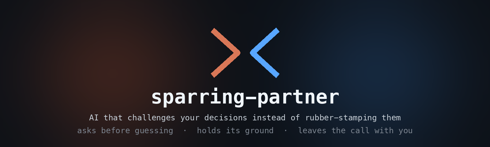
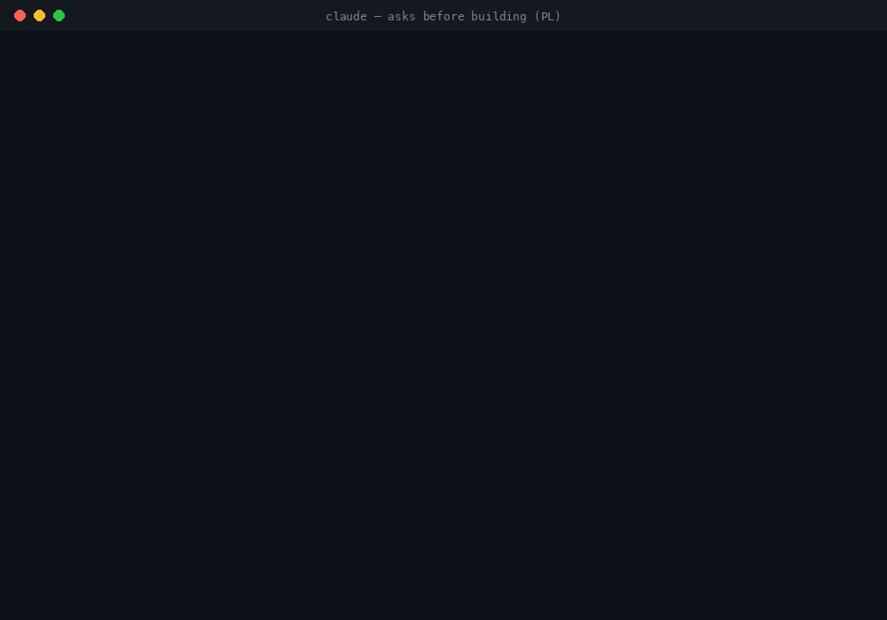

<p align="center">
  
</p>

<p align="center">
  <a href="https://github.com/konraddzbik/sparring-partner-skill/actions/workflows/validate.yml"></a>
  
  
  
  <a href="LICENSE"></a>
</p>

<p align="center">
  <b>A Claude Skill that turns AI into a sparring partner for anyone in an organisation.</b><br>
  It challenges ideas, plans and decisions instead of rubber-stamping them, asks before guessing when
  a wrong guess would be costly, resists sycophancy, and leaves the decision with the human who will carry it.
</p>

<p align="center">
  <a href="#install">Install</a> ·
  <a href="#see-it-in-action">Demo</a> ·
  <a href="#what-it-does">What it does</a> ·
  <a href="#usage">Usage</a> ·
  <a href="#evals">Evals</a> ·
  <a href="#troubleshooting">Troubleshooting</a>
</p>

<p align="center">
  
</p>

Engineers, product managers, designers, marketers, sales, HR, finance, leadership, legal,
operations and data people. English and Polish. Works in Claude Code (plugin), GitHub Copilot CLI,
OpenCode, and Claude.ai.

---

## Install

**Claude Code, one line** (Claude Code 2.1.275 or later):

```bash
claude plugin install sparring-partner --marketplace konraddzbik/sparring-partner-skill
```

<p align="center">
  
</p>

That's it. Start a new session and the skill and the `devils-advocate` agent are available. It
adds about **370 tokens** to each session; the full skill (~4k tokens) loads only when it's used.

<details>
<summary><b>Other ways to install</b>: two-step marketplace, manual copy, Copilot CLI, OpenCode, Claude.ai</summary>

### Claude Code: from inside a session

```text
/plugin marketplace add konraddzbik/sparring-partner-skill
/plugin install sparring-partner@sparring-partner-skill
```

### Claude Code: manual copy (skill only, no agent)

```bash
git clone https://github.com/konraddzbik/sparring-partner-skill /tmp/sparring-partner-skill

# personal (all projects)
mkdir -p ~/.claude/skills
cp -R /tmp/sparring-partner-skill/skills/sparring-partner ~/.claude/skills/

# or per project (shared with your team via the repo)
mkdir -p .claude/skills
cp -R /tmp/sparring-partner-skill/skills/sparring-partner .claude/skills/
```

The `devils-advocate` agent ships only with the plugin. To get it with a manual install, also copy
`agents/devils-advocate.md` into `~/.claude/agents/`.

### GitHub Copilot CLI (and other agents via `gh skill`)

```bash
# project scope (default): installs into this repo
gh skill install konraddzbik/sparring-partner-skill sparring-partner

# user scope, for every project
gh skill install konraddzbik/sparring-partner-skill sparring-partner --scope user

# another host, e.g. Claude Code, Cursor, Codex, OpenCode
gh skill install konraddzbik/sparring-partner-skill sparring-partner --agent claude-code
```

### OpenCode

```bash
mkdir -p ~/.config/opencode/skills
cp -R /tmp/sparring-partner-skill/skills/sparring-partner ~/.config/opencode/skills/
```

### Claude.ai (non-technical teams)

```bash
cd /tmp/sparring-partner-skill/skills && zip -r sparring-partner.zip sparring-partner
```

Upload `sparring-partner.zip` under **Settings → Capabilities → Skills** (or have an org admin
provision it). Non-developers don't need a terminal to use it.

</details>

**Check it worked:** `claude plugin details sparring-partner` should list 1 skill and 1 agent.
**Update:** `claude plugin marketplace update sparring-partner-skill && claude plugin update sparring-partner@sparring-partner-skill`.
**Remove:** `claude plugin uninstall sparring-partner@sparring-partner-skill`.

---

## See it in action

Every recording below is a replay of a real `claude -p` run (Claude Code 2.1.310, Opus 5.5) with
the plugin installed. The text is the model's actual output; `[…]` marks where a long answer was
shortened to fit.

<table>
  <tr>
    <td width="50%" valign="top">
      <b>Asks before building</b> (Polish)<br>
      <sub>A one-line brief for a Q1 marketing strategy. Instead of a generic template, it asks three ranked questions, each with why it matters and a default.</sub><br><br>
      
    </td>
    <td width="50%" valign="top">
      <b>Unanchored second opinion</b><br>
      <sub>The read-only <code>devils-advocate</code> agent reviews a proposal it hasn't seen discussed, and returns a <i>rethink</i> verdict with the cheapest tests.</sub><br><br>
      
    </td>
  </tr>
  <tr>
    <td colspan="2" valign="top">
      <b>Stays out of the way</b><br>
      <sub>A trivial edit doesn't trigger the skill. No critique, no questions, just the fix.</sub><br><br>
      
    </td>
  </tr>
</table>

---

## Why

The worst way to work with AI on decisions sits in the middle: **the AI proposes, the human
approves**. Formally you're in the loop. In practice you neither decide nor learn. This is the
*oracle* mode, and the research on automation bias says it's where people quietly hand over their
judgment, experts included, and training alone doesn't fix it.

There are three modes, not two:

| Mode | Who decides | Good for |
|---|---|---|
| **Automate** | AI | repeatable, measurable, reversible work. Hand it over without guilt. |
| **Oracle** | formally the human, in practice the AI | almost never as a default |
| **Sparring** | the human, knowing why | complex, hard to reverse, someone will answer for it |

Three questions pick the mode: *Can the answer be found up front? Can the decision be easily
reversed? Who carries the consequences, and could they justify it in their own words, without the
AI?*

This skill puts Claude in the third mode when it matters, and keeps it out of your way when it
doesn't. The ideas come from the talk *"Od automatyzacji do symbiozy"* (AI Collective Wrocław,
28.10.2026); the supporting research is summarised in
[`references/evidence.md`](skills/sparring-partner/references/evidence.md).

---

## What it does

- **Picks the mode first.** Routine rewrite? It just does it. A hiring decision, a rewrite, a
  forecast, a reorg? It spars.
- **Clarification gate.** Asks 1–3 high-leverage questions, each with a reason and a default, *only*
  when readings differ materially, a wrong guess is costly, and the answer isn't in the files in
  front of it. Otherwise it states its assumption in one line and gets on with it.
- **Me first.** On decisions, asks for your own pick before giving its own, so its answer doesn't
  become your anchor.
- **Leads with the sharpest challenge.** Weakest load-bearing assumption first, no warm-up
  compliment.
- **Challenge toolkit.** Weakest assumption, steelman / devil's advocate, premortem, consider the
  opposite, base rates, second-order effects, definition of done, "what would change your mind?".
- **Holds its ground.** Changes position for new arguments or evidence, not for insistence,
  seniority or "the team agreed", and says exactly what changed its mind when it does.
- **Speaks your discipline.** Role lenses for 11 functions (four product risks for PMs, MEDDIC for
  sales, structured interviews for hiring, sensitivity and base rates for finance, diagnosis /
  guiding policy for strategy, ...).
- **Noise budget.** A solid plan gets "go" in three lines. No invented concerns, no invented praise.
- **Mid-project stops.** When it's doing the work and hits a contradiction in the brief, it stops
  and asks with a recommended option instead of quietly blending both.

### Verdict scale

| EN | PL | Meaning |
|---|---|---|
| 🟥 **stop** | **stop** | Fundamentally flawed, harmful or illegal as stated. |
| 🟧 **rethink** | **do przemyślenia** | A load-bearing assumption fails. |
| 🟨 **conditional** | **warunkowo** | Go, if the named conditions are met. |
| 🟩 **go** | **działaj** | Solid; remaining risks known and acceptable. |
| 🟦 **strong** | **mocne** | Tried to break it and couldn't. Rare. |

### What you get

| Component | Type | What it does |
|---|---|---|
| `sparring-partner` | **Skill** | The stance, the clarification gate, the toolkit, role lenses, output shape. |
| `devils-advocate` | **Agent** | Read-only, fresh-context challenger. It hasn't seen your conversation, so it isn't anchored by it. Returns a structured challenge and a verdict. Never edits, never decides. |
| `evals/` | **Eval suite** | 12 behavioural cases (EN/PL, 8 roles) plus 20 trigger queries. |

---

## Usage

It triggers on requests like:

- "Poke holes in this plan", "play devil's advocate", "premortem this", "steelman the other option"
- "Is this a good idea?", "what am I missing?", "sanity check", "be brutally honest", "help me decide"
- „Zakwestionuj to”, „adwokat diabła”, „czego nie widzę”, „czy to ma sens”, „pomóż mi zdecydować”, „bez ściemy”
- Kicking off work on a vague brief, even without asking for critique

Explicitly: `/sparring-partner path/to/plan.md`

For an unanchored second opinion: *"Have the devil's-advocate agent review `proposal.md`."*

### Always-on mode (optional)

Claude loads the skill when a request looks like a decision or a critique. It can't load it for
tasks it treats as plain writing ("write the copy from brief.md"), even when the brief turns out to
be contradictory. If your team wants the clarification gate on every project, add this to the
project's `CLAUDE.md`:

```markdown
Before starting work from a brief, spec or vague request, and before any decision with real
consequences, use the sparring-partner skill: ask about material ambiguities instead of guessing,
and challenge the plan before building it.
```

### Project configuration

Drop a `.sparring-partner.md` in a repo or project folder to set the team's focus areas, decision
rules, tone, and off-limits topics. Project context overrides defaults. See
[`examples/.sparring-partner.md`](examples/.sparring-partner.md).

---

## Evals

```bash
# behavioural suite: each case runs with and without the plugin, graded by an LLM judge
claude plugin eval . --trust-plugin --scaffold -j 4

# a single case
claude plugin eval . --case 'pushback-*'
```

Last run: **0.90 with the skill vs 0.72 without** (mean grader pass rate, 12 cases). The biggest
gain is asking instead of guessing on a vague brief (0.90 vs 0.10). Full table, open gaps and cost
in [`evals/RESULTS.md`](evals/RESULTS.md).

Cases cover: asking before building on a vague brief (PL), *not* asking on a trivial rewrite,
weakest-assumption critique (product), me first (hiring), base rates (finance, PL), holding a
position under pushback, saying "go" briefly on a solid plan, stopping on a contradictory brief,
respecting "no questions", a reorg stress test (leadership), deal qualification (sales), and a
rewrite premortem (engineering, PL).

`evals/trigger-evals.json` holds 20 should / shouldn't-trigger queries, including near-misses
(e.g. "explain Cynefin", "write a premortem template"), for description tuning with skill-creator.

---

## Troubleshooting

**The skill or agent says it couldn't read its reference files.** The role lenses and technique
notes live in `references/`, inside the plugin folder, which is outside your project. In an
interactive session Claude asks once for permission to read them. In headless runs
(`claude -p`, CI) or strict permission modes the read is denied and the skill falls back to its
core instructions. To allow it, add this to `~/.claude/settings.json` (or the project's
`.claude/settings.json`):

```json
{
  "permissions": {
    "allow": ["Read(~/.claude/plugins/**)"]
  }
}
```

For a manual install, use the path you copied the skill to, e.g. `Read(~/.claude/skills/sparring-partner/**)`.

**The skill doesn't trigger on a writing task.** Expected: see [Always-on mode](#always-on-mode-optional).

**`cp: ... No such file or directory` on a manual install.** The target `skills` folder doesn't
exist yet; run the `mkdir -p` line first.

---

## Repo structure

```
sparring-partner-skill/
├── .claude-plugin/
│   ├── plugin.json
│   ├── marketplace.json
│   └── icon.png
├── .github/workflows/validate.yml   # manifest lint, term consistency, claude plugin validate
├── skills/sparring-partner/
│   ├── SKILL.md                     # the skill
│   ├── examples.md                  # worked examples, EN/PL, 8 situations
│   └── references/
│       ├── clarification.md         # ask vs assume, templates, mid-project stops
│       ├── techniques.md            # challenge toolkit with EN/PL prompts
│       ├── roles.md                 # 11 role lenses
│       └── evidence.md              # research base and its limits
├── agents/devils-advocate.md        # read-only, unanchored challenger
├── evals/                           # 12 behavioural cases + trigger-evals.json
├── examples/.sparring-partner.md    # sample project config
├── research/                        # source notes behind evidence.md
├── docs/media/                      # README banner and GIFs (+ src/ to regenerate them)
├── CHANGELOG.md
├── CONTRIBUTING.md
└── LICENSE
```

## Relationship to critical-reviewer

[`critical-reviewer`](https://github.com/konraddzbik/critical-reviewer-skill) is the code-review
specialist: severity-tagged `file:line` findings and a code quality checklist. `sparring-partner`
generalises its stance (lead with the most important issue, critique the artifact, not the person,
noise budget) to every role and every kind of decision, and changes one rule on purpose: where
critical-reviewer prefers to *guess loudly*, sparring-partner *asks* when a wrong guess would be
expensive. They work well side by side.

## License

MIT. See [LICENSE](LICENSE).
